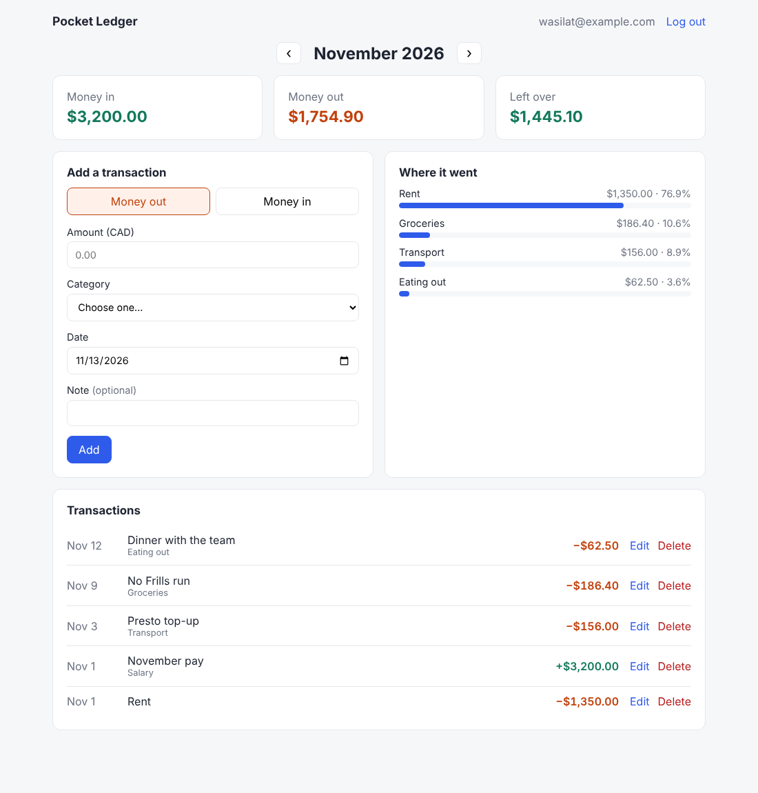

# Pocket Ledger

A personal finance tracker. Sign up, log what comes in and what goes out, and see at a glance where your money went each month.

**Live demo:** [wasilat-pocket-ledger.vercel.app](https://wasilat-pocket-ledger.vercel.app) · **Built by:** Wasilat Ayinla



## What it does

- Create an account and log in securely
- Add, edit and delete income and expenses, each with a category, date and optional note
- Flip between months and see money in, money out, and what's left over
- See which categories took the biggest share of your spending
- Works on phones as well as laptops

## Tech stack

| Layer | Tools |
| --- | --- |
| Frontend | React 18, Vite, plain CSS |
| Backend | Node.js, Express |
| Database | PostgreSQL |
| Auth | bcrypt password hashing, JWT in an httpOnly cookie |
| Testing | Node's built-in test runner, Supertest |
| CI | GitHub Actions (runs the API tests against a real Postgres database on every push) |

## Security decisions

I come from a cybersecurity background, so I built these in from the start rather than adding them at the end:

- **Passwords** are hashed with bcrypt (12 rounds) and never sent back to the browser.
- **Sessions** use a JWT stored in an `httpOnly`, `SameSite=Strict` cookie. JavaScript can't read it, which limits XSS damage, and other sites can't send it, which blocks CSRF.
- **Every query is scoped to the logged-in user**, so one user can never read, edit or delete another user's transactions. There's a test for this.
- **All input is validated twice:** in the browser for quick feedback, and again on the server, which never trusts the client.
- **Parameterized SQL everywhere**, so text like `'); DROP TABLE users; --` is stored as plain text. Also tested.
- **Login attempts are rate-limited** (20 per 15 minutes per IP), and a wrong email takes as long to reject as a wrong password, so attackers can't find out which emails have accounts.
- **Money is stored as whole cents**, never floating-point dollars, so totals never drift by a cent.
- `helmet` sets secure HTTP headers, and request bodies are capped at 10 KB.

## Run it locally

You need Node.js 22+ and Docker (or your own PostgreSQL).

```bash
# 1. Start Postgres
docker compose up -d

# 2. Start the API
cd server
cp .env.example .env        # then set JWT_SECRET to a long random string
npm install
npm run migrate
npm run dev                 # http://localhost:4000

# 3. In a second terminal, start the web app
cd client
npm install
npm run dev                 # open http://localhost:5173
```

## Tests

```bash
cd server && npm run test:unit   # validation, money and summary logic (no database needed)
cd server && npm test            # everything, including API tests (needs DATABASE_URL)
cd client && npm test            # client-side helpers
```

The API tests cover sign-up, login, logout, duplicate emails, wrong passwords, creating, editing and deleting transactions, monthly summaries, invalid input, SQL injection attempts, and one user trying to touch another user's data. **They wipe the database tables they use, so point `DATABASE_URL` at a test database, never real data.**

## Deploy (one service, one database)

In production, Express serves the built React app too, so the site and API share one domain and the login cookie works without any CORS setup.

1. Create a free PostgreSQL database (for example on Render or Neon) and copy its connection string.
2. Create a web service on Render (or similar) from this repo with:
   - **Build command:** `cd client && npm install && npm run build && cd ../server && npm install`
   - **Start command:** `cd server && npm run migrate && npm start`
   - **Environment variables:** `NODE_ENV=production`, `DATABASE_URL=<your connection string>`, `JWT_SECRET=<a long random string>`
3. Put the live URL at the top of this README and on your CV.

## Project layout

```
client/            React app (Vite)
  src/components/  AuthForm, Dashboard, SummaryCards, CategoryBreakdown, TransactionForm, TransactionList
  src/lib/         formatting and form validation helpers
server/            Express API
  src/routes/      auth and transactions endpoints
  src/lib/         validation, money and summary logic
  src/schema.sql   database tables
  tests/           unit tests and API tests
.github/workflows/ CI pipeline
```

## API

| Method | Path | What it does |
| --- | --- | --- |
| POST | `/api/auth/register` | Create an account |
| POST | `/api/auth/login` | Log in |
| POST | `/api/auth/logout` | Log out |
| GET | `/api/auth/me` | Who is logged in |
| GET | `/api/transactions?month=2027-05` | List a month's transactions |
| GET | `/api/transactions/summary?month=2027-05` | Totals and spending by category |
| GET | `/api/transactions/categories` | Allowed categories |
| POST | `/api/transactions` | Add a transaction |
| PUT | `/api/transactions/:id` | Edit one of your transactions |
| DELETE | `/api/transactions/:id` | Delete one of your transactions |

## What I'd add next

- Monthly budgets per category, with a warning when you get close
- CSV import from a bank statement
- A spending trend chart across the last 6 months
